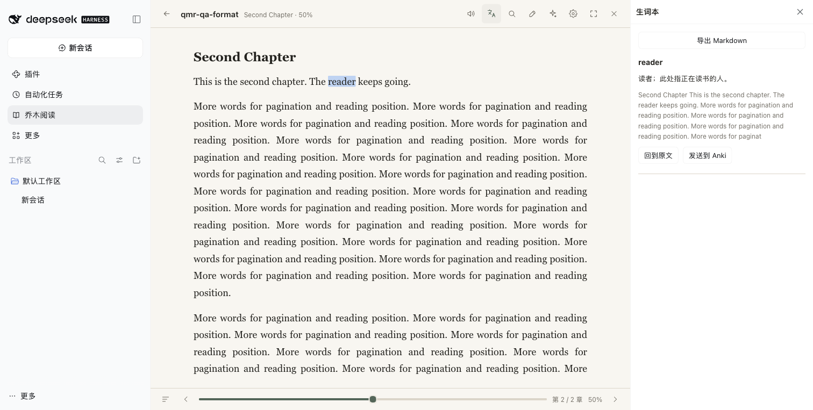

# 乔木阅读 · DeepSeek Harness

在 Harness 中读书、划线、听书和记笔记，通过宿主原生 AI 会话讨论正文。

> 当前开发分支正在迁移原版 4.9.2 的完整功能，尚未发布新版本。公开稳定包仍为 **1.1.0**。本页下方的新能力描述对应开发分支，逐项状态见 [功能对照与验收](docs/FUNCTIONAL-PARITY.md)，不代表全部迁移已经完成。



图为此前 1.1.0 在 macOS 隔离 Web profile 中的实际界面；新迁入的原版组件尚待浏览器验收，不用旧截图代替新版本证据。

## 开发分支的能力

- 书库、内置公版书、导入/恢复、目录、搜索、划线、批注和 Markdown 阅读笔记；新增原版 MOBI/AZW/AZW3/FB2/FBZ/CBZ 格式适配。
- 原版 Calibre 选书、公开书源和乔木书库界面；Kindle 的 KOReader / 原生两种传书模式及本机 EPUB → AZW3 转换。
- 通过 [乔木语音 0.1.1](https://github.com/joeseesun/qiaomu-audio-dsh/releases/tag/v0.1.1) 使用原版播放器、音色/模型设置、连续朗读、试听与恢复。请先在同一 Harness profile 安装 Audio；云端语音仍需要用户自己的有效服务配置。
- 原版免费 Google 查词/翻译卡、目标语言菜单、保存译文、生词本与复习卡。AI 翻译由用户主动切换到 Harness 原生会话；不会自动改用付费模型。
- 原版稳定阅读位置、印刷页码、命名书签、选文工具栏、字体选择/导入、PDF 缩放、计时与阅读统计。主题和图片查看器沿用原版。

不重新设计这些功能的 UI。`src/original` 保留上游代码与完整 CSS，Host/Client 适配层处理文件、凭证、工作线程、原生会话及卸载回收。

## 安装公开稳定版

从 [v1.1.0 Release](https://github.com/joeseesun/qiaomu-reader-dsh/releases/tag/v1.1.0) 下载预构建包与 `SHA256SUMS`：

```sh
shasum -a 256 -c SHA256SUMS
dsh plugin --profile YOUR_PROFILE add /absolute/path/qiaomu-reader-dsh-1.1.0.tgz
```

将 `YOUR_PROFILE` 替换为目标 profile，安装后重载该 profile。macOS 桌面版 CLI 位于 `/Applications/DeepSeek Harness.app/Contents/Resources/runtime/cli/bin/dsh`。**1.1.0 不包含上述全部新增适配**；不要把开发分支构建结果当成已公开发布的包。

## 数据与联网

书籍副本、阅读状态和笔记保存在配置的宿主书库 `乔木阅读/` 下，分别位于 `books/`、`state/`、`notes/`；更新生成的笔记时保留手写内容。导入字体位于 `_attachments/qiaomu-reader-fonts/`，按内容摘要命名并校验。书库移除可恢复，不会删除阅读资料。

主动查词向 Google 翻译服务发送所选文字；书源查询/下载访问所选服务。AI 上下文交给用户选择的 Harness 会话与模型，沿用原生授权流程。Kindle 仅在主动配对、查找、连接或发送时访问本机/局域网；私钥、书库激活凭证与语音服务密钥使用操作系统凭证存储，不写入发布包。

共享生词笔记默认在 `notes/生词本.md`，沿用原版 Spaced Repetition 格式并保留复习进度。可选 AnkiConnect 使用固定 `127.0.0.1:8765`、默认 `Qiaomu Reader` 牌组和 `Qiaomu Reader Vocabulary` 卡片模型；用户开启自动同步或主动点击发送时才请求本机 Anki。同步失败不会丢弃已经保存的词条。

## 验证范围与开发

此前稳定版已在 macOS / DSH 0.2.1-rc.3 隔离 profile 运行。新分支有格式、SSH/USB 夹具、状态持久化、DOM 交互、取消/卸载及真实 macOS 语音合成证据；新界面、公开新包与日用新 Reader 尚未验收。Google 实连请求返回限流错误；真实 Kindle 阅读、Anki 卡片、付费模型、Windows/Linux 与实体移动设备仍需分别验证。更多原版工作流还在对照，详见 [功能矩阵](docs/FUNCTIONAL-PARITY.md) 和 [迁移记录](docs/READER-ADAPTATION.md)。

```sh
npm ci
npm run check
npm pack --pack-destination /tmp
```

构建要求 Node.js 22.13+，Harness 0.2.1-rc.3。卸载时保留书库；回滚前先备份整个书库。旧版不理解新格式及部分设置，应先在隔离 profile 验证回滚，再决定是否替换日用版本。

原版基线为 `qiaomu-reader@4a6e6ee1e39966f2af5d831df8b3f4c4fd387ca3`，GPL-3.0-only。原版工作区未修改。Elton Reader、Lyceum、解析依赖、图标和朱雀仿宋字体的声明保留在 [第三方来源](THIRD_PARTY_NOTICES.md) 与 `licenses/`；示例书保留 Project Gutenberg 许可。

## English

This development branch adapts Qiaomu Reader 4.9.2 to DeepSeek Harness while retaining original product UI and styles. **The public stable release is still 1.1.0; this branch is not a completed or released full migration.** New adapters cover additional book formats, original Kindle/Calibre/library dialogs, Audio 0.1.1 speech integration, lookup and review cards, stable positions, fonts, PDF zoom, selection controls and reading statistics. See the [parity matrix](docs/FUNCTIONAL-PARITY.md) for implemented, tested and outstanding workflows.

Install the prebuilt stable tgz from the [1.1.0 Release](https://github.com/joeseesun/qiaomu-reader-dsh/releases/tag/v1.1.0), verify SHA256SUMS, then use `dsh plugin --profile YOUR_PROFILE add /absolute/path/package.tgz`. Stable 1.1.0 does not contain all new branch features. New speech requires Qiaomu Audio 0.1.1 in the same profile. AI uses native Harness conversations and user-controlled model authorization; no silent paid fallback.

Books, notes, progress and fonts remain local. Explicit Google lookup sends selected text to Google; the live check encountered rate limiting. Optional Anki uses localhost port 8765 and the original Qiaomu vocabulary model. Kindle connects only on explicit actions; sensitive credentials use the OS store. New browser UI, public package and daily runtime acceptance remain pending. Back up the library before rollback and preserve it during uninstall. GPL-3.0-only; third-party notices are shipped with the package.
