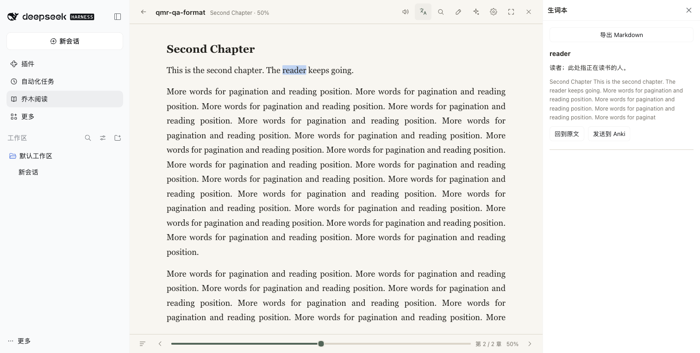
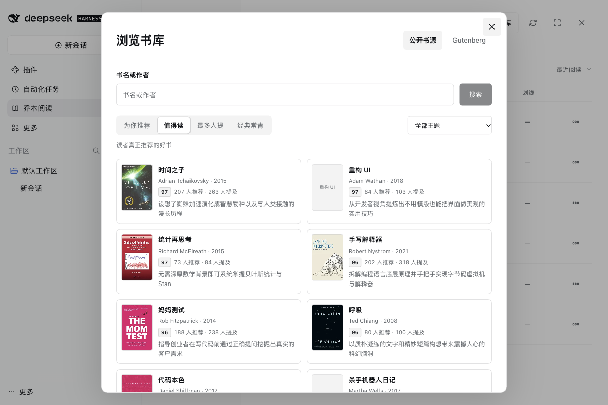
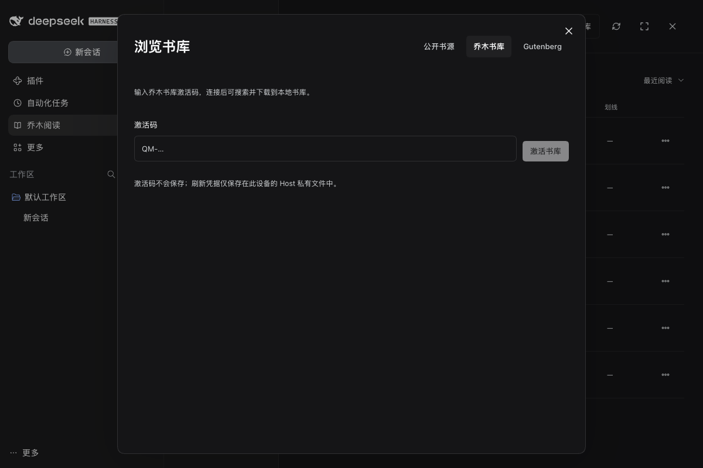
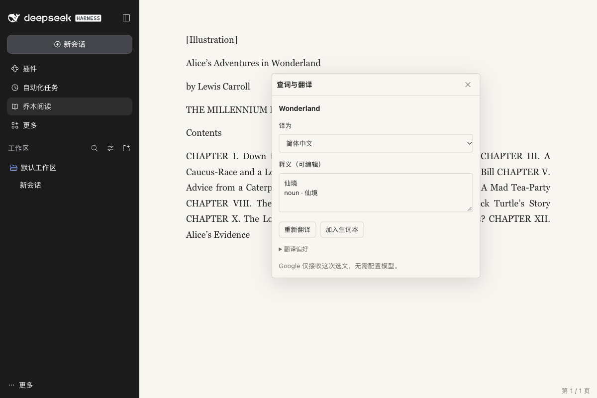
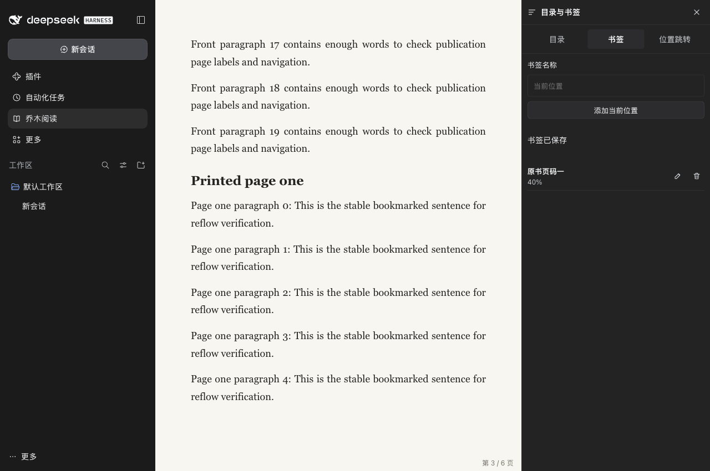
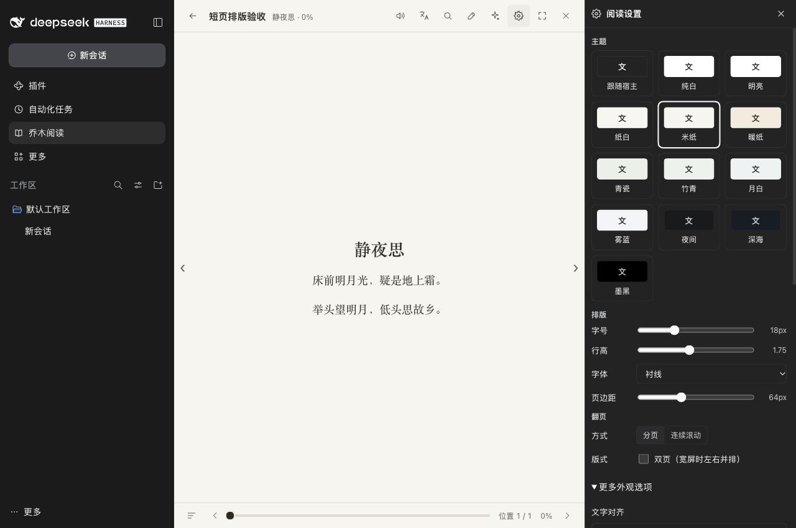
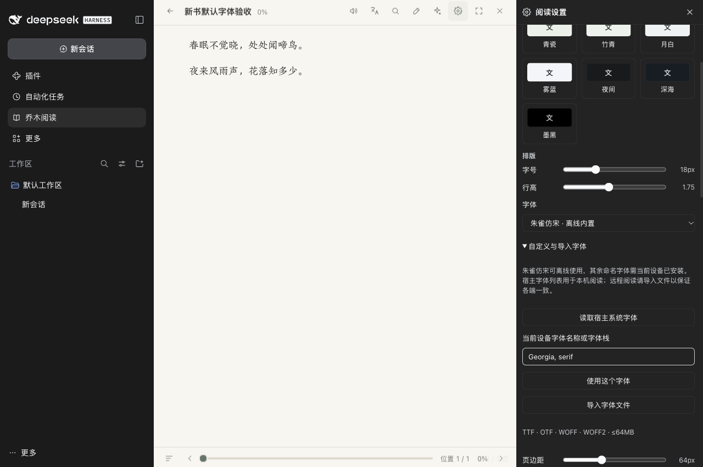

# 乔木阅读 · DeepSeek Harness

> v1.9.3：支持 DeepSeek Harness 0.2.2-rc.3；[本次兼容验证](docs/DSH-0.2.2-RC3.md)。保留 v1.9.0 的 PDF 伴读关联全文，超过 180000 字符均匀摘取并标注范围；恢复命名目的地、页内坐标和可点击内链。保留离线朱雀、完整主题、书签、翻译与朗读。[适配与验证范围](docs/READER-ADAPTATION.md)。

在 Harness 中阅读、划线、听书、记生词，使用宿主原生 AI 会话讨论正文。



图：1.1.0 预构建发布包，macOS 上的隔离 DSH Web profile；生词释义由测试人员输入，截图不代表模型回答已验收。

- 朱雀仿宋离线内置，新书默认使用，已有字体偏好保留；原版命名字体栈、宿主系统字体列表、自定义字体栈和TTF/OTF/WOFF/WOFF2导入，正文/伴读独立选择。
- 完整原版主题与跟随宿主、电子墨水模式；12–32字号、四种对齐、行宽/短页垂直对齐、工具栏与翻页偏好。
- EPUB、PDF、TXT、Markdown / HTML 导入；UTF-8、UTF-16 BOM 与 GB18030 文本解码。
- 命名书签与出版页码/稳定位置跳转；字号和窗口变化保持文本锚点，PDF支持真实目录、命名/坐标目的地、可点击内链、独立缩放及同页多次命中；缩放和窗口变化保留几何位置。
- PDF伴读提取整份文档并保留页码，超过180000字符均匀摘取；扫描页不伪造OCR，提取失败明确回退本页。
- 从书库移除后保留原副本、进度、划线、生词和 Markdown 笔记，可恢复或重新导入。
- 系统、Mac 本地、Edge、OpenAI/兼容、通义、豆包、MiniMax、硅基流动、ElevenLabs、Azure 语音；模型/音色配置、独立试听、段落前后、选文、跨章与位置恢复。
- Kokoro/MeloTTS 一键安装、进度/取消/重试；模型和 Python 环境独立于书库及系统 Python。
- 默认免费 Google 查词/翻译，目标语言可临时选择或保存默认；可切原生 AI 解释，未就绪时回退。
- 选区免费翻译和可选 Harness 原生 AI 解释；生词保留上下文与原文回跳，可导出 Markdown，可选 AnkiConnect。
- Hacker Books 榜单、主题、搜索、中文简介和 HN 评论；想读 / 读过与本地推荐。
- 乔木书库激活、配额状态、版本搜索、参考封面与下载恢复；EPUB/PDF/TXT 校验后加入本地书库。
- Gutenberg 搜索、EPUB 下载校验、已拥有提示；大书库窗口渲染。
- 快捷提示词可恢复内置；默认文案跟随语言，保存失败保留草稿。



图：1.3.0 隔离 DSH 0.2.1-rc.5，原版尺寸的卡片、真实封面与详情；主书库保留 C 列表。



图：实际安装包的未激活界面；成功下载流程经协议夹具验证，真实服务仍需输入用户激活码验收。



图：DSH Host 实际请求 Google，Wonderland→仙境；无需配置模型。朗读付费服务的协议测试不代表真实账号试听。



图：1.6.0 独立 DSH 安装版；EPUB 出版页码夹具和持久化书签，完整边界见适配记录。



图：1.7.0 隔离DSH真实安装，完整配色和短页居中；390px与电子墨水模式见适配记录。



图：1.8.0 独立DSH实际加载离线朱雀；字体资产在`$DSH_HOME/reader-fonts/`按书库隔离保存，备份阅读数据时应一并保存。远程设备未安装的系统字体需用文件导入；导入不安装OS字体。

## 安装预构建发布包

从 [v1.9.3 Release](https://github.com/joeseesun/qiaomu-reader-dsh/releases/tag/v1.9.3) 下载 `qiaomu-reader-dsh-1.9.3.tgz` 和 `SHA256SUMS`，校验后安装到你选择的 profile：

```sh
shasum -a 256 -c SHA256SUMS
dsh plugin --profile YOUR_PROFILE add /absolute/path/qiaomu-reader-dsh-1.9.3.tgz
```

`YOUR_PROFILE` 需要替换为目标 profile。macOS 桌面版请使用应用自带 CLI：`/Applications/DeepSeek Harness.app/Contents/Resources/runtime/cli/bin/dsh`。不要把隔离测试配置直接覆盖日用配置。

此前 1.9.0 基线：macOS、应用自带 DSH 0.2.1-rc.5、独立 Web profile；日用桌面已安装预构建包并重启，原有六本书、进度与划线保留。其他系统、实体手机和平板未验收。详细记录在 [适配状态](docs/READER-ADAPTATION.md)。

## 使用

打开左侧「乔木阅读」，导入书籍。选中文字可划线、查词或交给 AI；右上角可打开朗读、生词本、搜索与伴读。书目更多菜单中的「从书库移除」保留全部阅读文件，在「已移除书籍」中恢复。

默认书库在宿主工作目录下的 `乔木阅读/`，由 `workspaceRoot` 配置固定；书籍、状态、生成的笔记分别在 `books/`、`state/`、`notes/`。更新笔记只替换受管理区块，保留手写文字。不要删除这些目录来卸载插件。

免费查词无需模型，只有本次选文发送 Google；AI 解释需要用户在 Harness 配置模型，打开独立原生会话并提供上下文，点击「生成解释」后发送；可直接手填释义。Anki 需要在本机安装并运行 AnkiConnect，默认使用 `Default` 牌组的 `Basic` 笔记类型及 `Front` / `Back` 字段。

## 数据与联网

阅读副本和结构化状态保存在本机，浏览器保留离线缓存。公开书单访问 Hacker Books，Gutenberg 搜索/下载访问 `www.gutenberg.org`；可选乔木书库访问 `ebook-mcp.qiaomu.ai/reader/api`，参考封面访问 Open Library。乔木书库刷新凭据仅保存在 Host 私有目录（0700/0600，本机权限控制，未宣称加密），不随书库或导出笔记传出；激活码不保存。浏览器语音使用运行环境所提供的声音，其联网行为由该环境决定。Mac 语音优先 AVFoundation（保留旧 say 音色兼容），Edge 将播放文字发送微软；其他在线语音发送所选服务，密钥保存在 Host 私有文件。Kokoro/MeloTTS 本机合成，首次下载固定摘要的模型和独立运行环境；模型及缓存位于 `$DSH_HOME/reader-tts` / `$DSH_HOME/cache/reader-tts`。只有点击发送到 Anki 才访问固定本机端口 `127.0.0.1:8765`。AI 上下文交给用户选择的 Harness 模型，沿用宿主账号、工具与授权机制；本插件不搬迁原版 AI 密钥。

## 当前边界

本轮交付阅读/书库的第一阶段。乔木书库代码与协议夹具闭环已完成；真实服务激活下载需用户输入激活码后另行验收。云端语音已接入原版协议及设置，真实付费账号试听仍需用户密钥；Edge、Mac、Kokoro/MeloTTS 本机合成已验证，日用两本地模型试听成功。Kindle 双模式传书和其余完整对照表事项继续迁移。MOBI、FB2、漫画不在本版支持范围。分页页码随窗口和排版变化，不宣称全书稳定页码。AI 实际回答、真实 Anki 卡片与 Kindle 设备阅读分别未验收。

若需回滚，重新安装此前已验证的包并重载 profile，先备份整个 `乔木阅读/`。旧版不认识新增的 Markdown/HTML 书籍及归档字段，不应用旧版执行书库修改。卸载插件时保留书库与浏览器缓存。

## 开发

```sh
npm ci
npm run check
npm pack --pack-destination /tmp
```

保留 GPL-3.0-only；原产品稳定版对照基线为 `qiaomu-reader` 提交 `4a6e6ee1e39966f2af5d831df8b3f4c4fd387ca3`（4.9.2）。原版工作区未修改。PDF.js、Marked、parse5 及其打包依赖的许可证见 [第三方来源说明](THIRD_PARTY_NOTICES.md)；六本内置公版书保留原始来源与许可。

## English

Read EPUB, PDF, TXT, Markdown and HTML inside DeepSeek Harness, with Hacker Books discovery, local reading lists and recommendations, recoverable library removal, speech, vocabulary, Markdown backlinks and native AI sessions. Quick prompts support localized defaults, reset and retryable saves. Install the **prebuilt Release tgz** with `dsh plugin --profile YOUR_PROFILE add /absolute/path/package.tgz`, then reload the selected profile. Download the prebuilt tgz and SHA256SUMS from the v1.9.3 GitHub Release; no npm publication is provided.

Previous 1.9.0 baseline: Tested on macOS with bundled DSH 0.2.1-rc.5 in an isolated Web profile and installed in the ordinary desktop profile with existing books preserved. Windows/Linux and physical mobile devices are not verified. AI replies require the user's native Harness model configuration. AnkiConnect is optional. Qiaomu Library activation/search/download is implemented and fixture-tested; real activated service downloads still require the user’s activation code. Speech providers and Kokoro/MeloTTS setup are implemented. Edge/Mac synthesis and both local-model auditions passed; paid provider accounts still require user keys. Kindle, MOBI/FB2/comics and stable whole-book pagination remain separate parity tasks.

Books, notes and state are stored locally. Qiaomu Library optionally contacts ebook-mcp.qiaomu.ai; refresh credentials stay in permission-controlled Host files outside the book library. Reference covers use Open Library. Gutenberg search/download contacts Gutenberg; AI context goes to the configured Harness provider; explicit Anki export uses localhost port 8765. Mac speech uses AVFoundation with legacy say compatibility. Google receives only the selected lookup text. Online speech uses the selected provider; local models use an independently installed runtime outside the book library. Uninstall the plugin through Harness while keeping its library files; back up the library before rollback. Licensed GPL-3.0-only.

Harness 0.2.2-rc.3 适配与实测边界见 [兼容验证记录](docs/DSH-0.2.2-RC3.md)。
